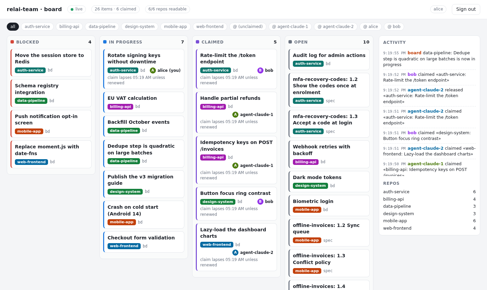

# relai-team

**An optional, self-hosted team board for humans and AI agents working across many repos.**

This server is optional. The [Relai](https://github.com/ECG-Rudy-Glt/RELAI) CLI works alone with only git, and
never depends on this project. Add the server when several people or agents work in parallel on the same
projects. What it adds:

- one live board (a web page) over the work that already lives in your repos: Beads tasks, OpenSpec changes,
  `TODO.md` / `TASKS.md` checklists, and open GitHub or GitLab issues (read-only);
- **claims**: a person or agent claims a task so two of them never start the same one. Claims lapse after a
  lease (default 8 h), so a crashed agent never blocks work;
- **MCP tools** (`relai-mcp`) so Claude Code, Codex and other MCP clients can list, claim and release work;
- per-person tokens, optional HTTPS, and no database: claims live in an append-only log (`events.jsonl`).

The repos stay the source of truth: the board is a view of them plus a claim register.

```
  repo A  (relai.yaml, .beads, openspec/)  ─┐
  repo B  (relai.yaml, .beads, openspec/)  ─┼─►  relai-server  ◄── HTTP (bearer token) ── people, scripts
  repo C  …                                ─┘   board + claims            ▲
                                                 events.jsonl             │ stdio
                                                                  relai-mcp ◄── Claude Code, Codex, …
```



## Quick start

You need `git`, plus `bd` ([Beads](https://github.com/steveyegge/beads)) and `openspec` for the parts you
want shown.

```sh
go install github.com/ECG-Rudy-Glt/RELAI-TEAM/cmd/relai-server@latest   # or: go build ./cmd/relai-server

relai-server init --scan ~/work          # finds your repos that have Beads / OpenSpec / relai.yaml
relai-server -config ./config.json       # then open http://localhost:8080/board
```

`init` writes `config.json` (mode 0600) with one random token per member and prints the tokens **once**: only
their hashes are stored. It refuses to overwrite an existing config. The first member is the administrator.
Options: `--repos a,b` (paths or clone URLs), `--members`, `--listen`, `--dir`, `--force`.

**The board is empty?** If `bd` or `openspec` is not on the server's `PATH`, the repo is listed but its tasks
are not, and the server warns at startup. Install the tool, or use Docker, which bundles all three.

**Nothing to try it on?** `scripts/demo-repos.sh /tmp/demo` makes six fictional repos.

### With Docker (no Go, no bd, no openspec on your machine)

```sh
mkdir -p config data
# either `relai-server init`, or write the file by hand:
cat > config/config.json <<'EOF2'
{
  "listen": ":8080",
  "data_dir": "/data",
  "refresh_interval": "30s",
  "repos": ["/repos/auth-service", "/repos/billing-api"],
  "members": [
    {"identity": "alice",          "token": "change-me-1"},
    {"identity": "agent-claude-1", "token": "change-me-2"}
  ]
}
EOF2
RELAI_TEAM_REPOS=$HOME/work docker compose up -d     # $HOME/work/auth-service → /repos/auth-service
curl -H 'Authorization: Bearer change-me-1' localhost:8080/items

# or run the published image (from the first release on; it needs the same config and secrets as the compose file)
docker pull ghcr.io/ecg-rudy-glt/relai-team:latest
```

- `RELAI_TEAM_REPOS` is mounted **read-write** (`bd` writes lock files in `.beads/` even to read). The container
  runs as `RELAI_TEAM_UID:RELAI_TEAM_GID` (default `1000:1000`): set them to the owner of your repos.
  `./data` must be writable by that user too. `RELAI_TEAM_PORT` changes the published port (default 8080).

### Connect an agent

Each agent runs its own `relai-mcp` with its own token, so every claim is attributed to it:

```sh
go install github.com/ECG-Rudy-Glt/RELAI-TEAM/cmd/relai-mcp@latest
claude mcp add relai-team -e RELAI_TEAM_URL=http://localhost:8080 -e RELAI_TEAM_TOKEN=change-me-2 -- relai-mcp
```

The tool list, other MCP clients and HTTPS options are in [`docs/reference.md`](docs/reference.md).

## Status and limits

v0.x. Done: change-driven aggregation, claims with leases and force-release, persistence, token auth, HTTP
API, event stream, web board, HTTPS, private repos, issue mirrors, `init`, Docker, MCP tools. Not started:
deployment presets.

- One active server at a time (an optional `-standby` process can take over); claims live in the server's log,
  not in Beads; the web board is read-only. Use HTTPS beyond a private network.
- Tried once with three Claude Code agents asking for tasks at the same moment: no task was taken twice.
- Task titles are untrusted text that reaches AI agents: treat them as data.

## Read more

- [`docs/reference.md`](docs/reference.md): setup variants, web board, MCP tools, configuration table, HTTP API,
  claims, private repos, repo discovery, issue mirrors, HTTPS, why it does not poll Beads, deployment limits
- [SECURITY.md](SECURITY.md), [CONTRIBUTING.md](CONTRIBUTING.md), `openspec/` (specs and history)

## Licence

[Apache-2.0](LICENSE).
