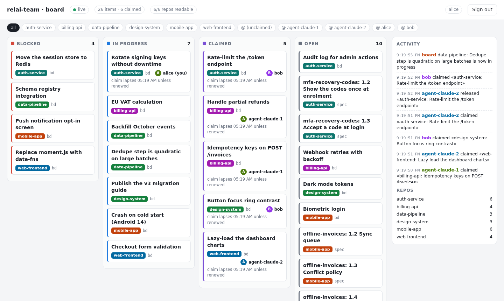

# relai-team

**A self-hosted team board for humans and AI agents working across many repos.**
It reads the work that already lives in git (Beads tasks, OpenSpec changes), shows it as one live
board, and lets each person or agent *claim* a task so two of them never start the same one.

No new place to keep tasks: the repos stay the source of truth, the board is a view of them plus a
claim register. It is the optional team layer for [Relai](https://github.com/ECG-Rudy-Glt/RELAI) —
Relai itself stays git-only with no server, and never depends on this project.

```
  repo A  (relai.yaml, .beads, openspec/)  ─┐
  repo B  (relai.yaml, .beads, openspec/)  ─┼─►  relai-server  ◄── HTTP (bearer token) ── people, scripts
  repo C  …                                ─┘   board + claims            ▲
                                                 events.jsonl             │ stdio
                                                                  relai-mcp ◄── Claude Code, Codex, …
```



<sub>Ten seconds of a team working on six fictional projects. Dark mode follows your system:
[`docs/images/board-dark.png`](docs/images/board-dark.png); filtered to one agent:
[`docs/images/board-filtered.png`](docs/images/board-filtered.png).</sub>

## What you get

- **One live board** over every declared repo, with a **web page** (`/board`) that updates the moment
  something changes. A task closed in Beads, or ticked in an OpenSpec `tasks.md`, shows up within one
  refresh cycle (default 30 s).
- **Easy on your disk.** Unchanged repos cost nothing: no process is started and nothing is written
  (see "Why it does not poll Beads").
- **Claim / release with a guarantee.** Exactly one claim wins when several agents ask at once; the
  others are told who holds it. Claims **lapse** after a lease (default 8 h) unless renewed, so a
  crashed agent never blocks a task, and an administrator can free one by hand.
- **Agent tools (MCP).** `relai-mcp` gives Claude Code, Codex and other MCP clients five tools to
  list, claim and release work, as their own identity.
- **Claims survive restarts.** An append-only event log (`events.jsonl`), no database to run.
- **Per-person tokens, optional HTTPS.** Every request is authenticated as a declared team member;
  set a certificate and key and the server speaks HTTPS itself.
- **Honest about gaps.** A repo the server cannot read is reported as unreadable, never silently
  dropped or shown stale.

## Quick start

You need `git`, plus `bd` ([Beads](https://github.com/steveyegge/beads)) and `openspec` for the parts you
want shown. Then three commands:

```sh
go install github.com/ECG-Rudy-Glt/RELAI-TEAM/cmd/relai-server@latest   # or: go build ./cmd/relai-server

relai-server init --scan ~/work          # finds your repos that have Beads / OpenSpec / relai.yaml
relai-server -config ./config.json       # then open http://localhost:8080/board
```

`init` writes `config.json` (mode 0600) with one random token per member and prints the tokens **once**:
only their hashes are stored. It refuses to overwrite an existing config.

```text
$ relai-server init --scan ~/work --members alice,agent-1,agent-2
Wrote /home/you/config.json (6 repos, 3 members)

Tokens. Shown once: the config keeps only their hashes. Give each person theirs.
  alice            rt_a432…  (administrator)
  agent-1          rt_29a2…
  agent-2          rt_7be0…

Next
  1. relai-server -config /home/you/config.json
  2. open http://localhost:8080/board and paste a token
  3. for an agent:  claude mcp add relai-team -e RELAI_TEAM_URL=http://localhost:8080 -e RELAI_TEAM_TOKEN=rt_7be0… -- relai-mcp
```

Options: `--repos a,b` (paths or clone URLs) instead of or besides `--scan`, `--members`, `--listen`,
`--dir`, `--force`. The first member is the administrator.

**Nothing to try it on?** Make fictional projects first:

```sh
scripts/demo-repos.sh /tmp/demo           # six small repos with Beads tasks and OpenSpec changes
relai-server init --scan /tmp/demo --dir /tmp/demo-board
relai-server -config /tmp/demo-board/config.json
```

### With Docker (no Go, no bd, no openspec on your machine)

```sh
mkdir -p config data
# either `relai-server init`, or write the file by hand:
cat > config/config.json <<'EOF2'
{
  "listen": ":8080",
  "data_dir": "/data",
  "refresh_interval": "30s",
  "repos": ["/repos/auth-service", "/repos/billing-api"],
  "members": [
    {"identity": "alice",          "token": "change-me-1"},
    {"identity": "agent-claude-1", "token": "change-me-2"}
  ]
}
EOF2
RELAI_TEAM_REPOS=$HOME/work docker compose up -d     # $HOME/work/auth-service → /repos/auth-service
curl -H 'Authorization: Bearer change-me-1' localhost:8080/items
```

- The image bundles `git`, `bd` (Beads) and `openspec`, which the server reads repos through.
- `RELAI_TEAM_REPOS` is mounted **read-write**: `bd` writes lock files in `.beads/` even to read.
  The container runs as `RELAI_TEAM_UID:RELAI_TEAM_GID` (default `1000:1000`); set them to the owner
  of your repos so no root-owned files appear in them. `./data` must be writable by that user too.
- `RELAI_TEAM_PORT` changes the published port (default 8080). Claims survive `docker compose restart`.

### Bare binary

Needs Go 1.23+, and `git`, `bd` and `openspec` on `PATH` for the parts you want read.

```sh
go build -o relai-server ./cmd/relai-server
./relai-server -config config.json        # or: RELAI_TEAM_CONFIG=config.json ./relai-server
```

## Web board

Open `http(s)://<host>:8080/board` (the server root redirects there). The page holds no data: it asks
for your token, keeps it in that browser tab only (`sessionStorage`, forgotten when the tab closes),
and then reads the same authenticated API as everything else. Columns: *Blocked*, *In progress*,
*Claimed*, *Open*; filters by repo and by person; an activity feed of who claimed or released what.
It updates live over the event stream, and falls back to polling if the stream is cut. It is
read-only: claiming is done by people through the API and by agents through MCP.

## Agents (MCP)

Each agent runs its own `relai-mcp`, pointed at the shared server with **its own token**, so every
claim is attributed to the right identity.

```sh
go install github.com/ECG-Rudy-Glt/RELAI-TEAM/cmd/relai-mcp@latest

claude mcp add relai-team -e RELAI_TEAM_URL=http://localhost:8080 -e RELAI_TEAM_TOKEN=change-me-2 -- relai-mcp
```

Over HTTPS with a self-signed or private certificate, add `RELAI_TEAM_CA_FILE=/path/to/cert.pem`.
`relai-mcp` warns on stderr if you point it at plain `http://` on another machine.

Any MCP client that can launch a stdio server works: the command is `relai-mcp` and the two
environment variables are `RELAI_TEAM_URL` and `RELAI_TEAM_TOKEN`. As a project `.mcp.json`:

```json
{ "mcpServers": { "relai-team": {
    "command": "relai-mcp",
    "env": { "RELAI_TEAM_URL": "http://localhost:8080", "RELAI_TEAM_TOKEN": "change-me-2" } } } }
```

| Tool | What it does |
|---|---|
| `board_repos` | Declared repos, item counts, which ones could not be read. |
| `board_items` | Work items, filterable by `repo`, `status`, `holder` (`none`, `me`, or an identity). `(you)` marks your own. |
| `board_claim` | Claim one item. If someone holds it, the answer names them: pick other work. Claiming your own item again renews it; your items show when their claim lapses. |
| `board_release` | Release an item you hold. Administrators can pass `force` to free someone else's (a crashed agent's, say). |
| `board_claim_next` | Claim the first unclaimed, non-blocked item (optionally in one repo). Safe when many agents ask at once. |

Refusals come back as ordinary tool results, not crashes, so an agent just moves on.
The token lives in the client's MCP config: treat that file like any other secret.

**Tried with real agents:** three Claude Code agents, each with its own token, were told at the same
moment to take up to 3 tasks from a repo with 6. They ended with 3 + 1 + 2 tasks, no task twice,
and the two that ran out were told so cleanly.

## Configuration (JSON)

| Field | Default | Meaning |
|---|---|---|
| `listen` | `:8080` | Address to listen on. |
| `data_dir` | `data` | Holds `events.jsonl`. |
| `claim_lease` | `8h` | How long a claim lasts unless its holder claims again to renew it. `0s`: claims never lapse. |
| `git_credentials` | — | For private repos declared by clone URL: `[{"host":"github.com","token_env":"GITHUB_TOKEN"}]`. The token is read from that environment variable, never from this file. Optional `username` (default `x-access-token`; GitLab wants `oauth2`). See "Private repos". |
| `git_ssh_key`, `git_known_hosts` | — | Private key (and optionally a `known_hosts` file to verify against) for `git@…` / `ssh://` remotes. |
| `refresh_interval` | `30s` | How often repos are *checked* for changes (Go duration, at least 1s). Checking is cheap; only changed repos are read. |
| `full_refresh_interval` | `6h` | Longest an *unchanged* repo is trusted before being read again anyway (safety net). `0s` reads every repo every cycle: expensive, see below. |
| `refresh_concurrency` | `8` | How many changed repos are read at once. |
| `tls_cert`, `tls_key` | — | PEM files; set both to serve HTTPS (TLS 1.2+), or neither. |
| `repos` | — | Local paths or clone URLs. A clone URL is only cloned when its remote HEAD moved. |
| `members` | — | `{"identity", "token"}` or `{"identity", "token_sha256"}` (hex SHA-256, so the file holds no plaintext secret), and `"admin": true` to let that member force-release others' items. |

Config is read at startup; restart to change members or repos.

## HTTP API

All routes except `/healthz` need `Authorization: Bearer <token>`.

| Route | Result |
|---|---|
| `GET /healthz` | `{"status":"ok"}` (no auth) |
| `GET /me` | Your identity. |
| `GET /repos` | Declared repos with `readable`, `items`, `notes`. |
| `GET /repos/{repo}/items` | Items of one repo; `404 repo not tracked` if undeclared. |
| `GET /items`, `GET /items/{id}` | Work items with `holder` and `claimed_at`. |
| `POST /items/{id}/claim` | `200` with you as holder and `expires_at`; `409` + current holder if taken. Claiming an item you already hold **renews** it. |
| `POST /items/{id}/release` | `200`; `409` if someone else holds it. Add `?force=true` as an administrator to free an item someone else holds (`403` for anyone else; the log records who did it). |
| `GET /events` | Server-Sent Events stream: one `change` event whenever the board changes (no board data in it: re-fetch `/items`). |
| `GET /board` | The web board (public, no data in the page). |

Item IDs contain slashes (`auth-service/bd/auth-service-0p2`): **URL-encode them** in the path
(`auth-service%2Fbd%2Fauth-service-0p2`), or you get a 404. (`relai-mcp` does this for you.)

## Claims, leases and force-release

A claim lasts `claim_lease` (default 8 h) from the moment it was made. While it lasts the item shows
who holds it and when it lapses; after that it counts as unclaimed and anyone can take it. The holder
renews by **claiming the item again** (agents are told this by the tool text). So a crashed or closed
agent frees its tasks by itself, with no clean-up job: the lapse is computed when the board is read,
from the time already in the event log, which makes it identical after a restart.

An administrator (`"admin": true` on the member; `init` makes the first member one) can free an
item held by someone else with `board_release … force` or `POST …/release?force=true`. Nobody else
can, and an administrator who does not ask for `force` is treated like any member. The log keeps both
names (the former holder and who freed it).

## Private repos

Repos declared by clone URL can be private. Tell the server how to authenticate per host, and keep the
secret itself in the environment:

```json
{
  "repos": ["https://github.com/acme/billing-api.git", "git@github.com:acme/infra.git"],
  "git_credentials": [{ "host": "github.com", "token_env": "GITHUB_TOKEN" }],
  "git_ssh_key": "/run/secrets/id_ed25519",
  "git_known_hosts": "/run/secrets/known_hosts"
}
```

```sh
GITHUB_TOKEN=ghp_… relai-server -config config.json       # Docker: put it in config/secrets.env
```

- The token is sent only over **HTTPS**, as a request header scoped to that exact host: never in a URL,
  a command line, a log or an API answer. A repo URL that contains a password or token
  (`https://user:pw@…`) is refused at startup, since the URL is shown to every member.
- For GitHub use a fine-grained token with read access to *Contents*; for GitLab set `"username": "oauth2"`.
- git never waits for a person: a missing or wrong credential fails at once and `/repos` says why
  (`authentication required for github.com: no credential configured`, `authentication refused … check
  the token in $GITHUB_TOKEN`), without ever printing the token.
- Without `git_known_hosts`, SSH accepts a host's key the first time it sees it (weaker); with it, keys
  are verified strictly.
- A private repo is cloned only when its remote HEAD moved (`git ls-remote`, no disk writes), like the
  rest of the change-driven refresh.

## HTTPS

```json
{ "tls_cert": "/etc/relai-team/cert.pem", "tls_key": "/etc/relai-team/key.pem" }
```

Both or neither (the server refuses to start with only one). Listening beyond loopback **without**
them logs a warning at startup, because tokens then travel in clear. A reverse proxy that terminates
TLS works just as well; the event stream needs response buffering off (`X-Accel-Buffering: no` is
already sent for nginx). For a quick self-signed certificate:

```sh
openssl req -x509 -newkey ec -pkeyopt ec_paramgen_curve:prime256v1 -nodes -keyout key.pem -out cert.pem \
  -days 365 -subj /CN=localhost -addext "subjectAltName=DNS:localhost,IP:127.0.0.1"
```

## Why it does not poll Beads

Every `bd` run rewrites its embedded Dolt database on disk, about 2–3 MiB of journal, index and
manifest, **even for a read, even with `--readonly`**. A server that ran `bd list` on every repo at
every refresh was measured at ~9.5 MB/s of disk writes (~790 GiB/day) with nothing happening, enough
to heat an NVMe drive to 80 °C. So relai-team never polls Beads blindly:

- A repo is **fingerprinted** with a few `stat` calls (no process): `relai.yaml`, `.beads/last-touched`
  (Beads rewrites it on every write and never on a read) and `openspec/changes`. `bd` and `openspec`
  run only when that fingerprint changes, so a task change appears within one `refresh_interval` and an
  idle board writes nothing.
- A clone URL is checked with `git ls-remote` (no disk writes) and cloned only when its HEAD moved.
- `full_refresh_interval` (default 6 h) re-reads every repo anyway, in case something changed that the
  fingerprint cannot see. A repo whose Beads reading fails is not retried every cycle.
- The server logs `refresh: re-read N repo(s)…` only when it actually read something. If you see that
  line constantly, something is rewriting those repos' files.

Setting `full_refresh_interval` to `0s` turns all of this off. Do not leave it on a laptop.

## Know before you deploy

- **Claims live in the server's log, not in Beads.** A `bd update --claim` done by hand is not seen
  as a claim on the board.
- **Single instance.** State is held in memory and one log file; do not run two servers on one log.
- **Static tokens.** Git tokens and member tokens do not rotate by themselves: change them and restart.
- **The web board is read-only**, and protected by the same tokens: use HTTPS for anything beyond a
  private network.
- **First read cost.** Starting the server reads every repo once (about 2.5 s for ten repos on four
  cores, in parallel); after that, only changes.

## Status

v0.x. Done: aggregation (parallel, change-driven), claims, persistence, token auth, HTTP API, event
stream, web board, HTTPS, claim leases and force-release, private repos, `init`, Docker packaging,
MCP tools.
Not started: deployment presets (deliberately deferred — see `.relai/notes.md`).
Specs and history live in `openspec/` (`specs/` for what is true now, `changes/archive/` for how it
got there); open tasks are in Beads (`bd ready`).

## Why a separate repo, not a mode of Relai

It keeps Relai's "git only, no server" promise intact instead of turning it into "git only,
except…". It matches Relai's own *compose, don't rebuild* principle: this project reads Relai's
repo contract (`relai.yaml`, Beads, OpenSpec) through their own CLIs and files, with no code
coupling back. And it lets this idea succeed or fail on its own without touching Relai's
credibility. Details: `openspec/changes/archive/*-team-server-foundation/proposal.md`.

## Contributing / picking up work

This repo uses Relai on itself. Start here:

```sh
relai handoff     # or: bd ready, if relai isn't installed — see AGENTS.md
```

Pick an unblocked task, do the work, commit (conventional style), update `.relai/notes.md` for
whoever picks this up next. Before committing: `gofmt -l .` (empty), `go vet ./...`, `go test ./...`.

## Licence

[Apache-2.0](LICENSE).
